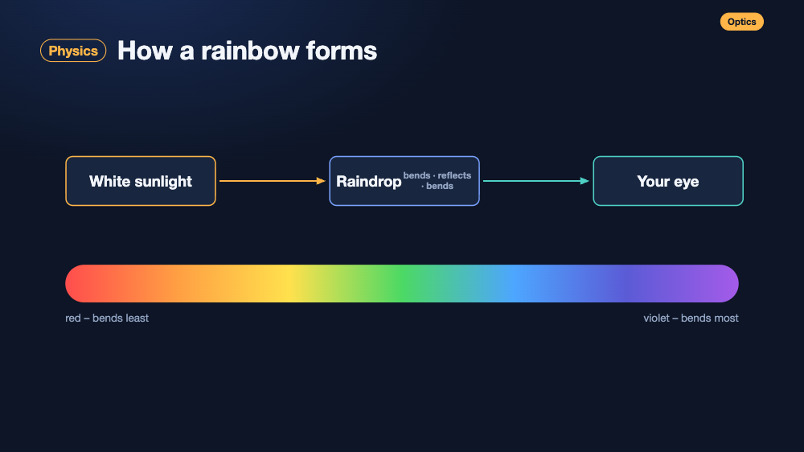
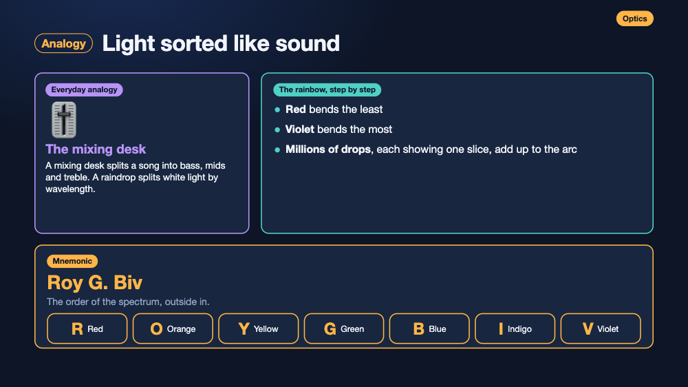

# explainer-video

**Drop in your material. Tell it how you learn. Get a personal course of narrated explainer videos – built as code, not generated.**
Animated diagrams (HTML/SVG/CSS) are locked word-for-word to an [ElevenLabs](https://elevenlabs.io) voice-over, so picture and
voice can never drift. Export to MP4, publish as a free study website, or just play it in the browser.




* **Learns *you* first** – a short *learntype brainstorm* (how do you learn? which analogies click?) produces a learner profile that drives curriculum order, depth, pace, humour, voice, examples and mnemonics.
* **Follows your study plan** – connect your calendar (ICS/iCal/OpenOlat feed): the skill works out what each study block is about, scans the course pages with a browser (you sign in) for the preparation reading, and combines books, slides, photos, voice-note transcripts and emails. Videos are ready before each block.
* **Synthesises a curriculum** from a pile of PDFs, Word, slides and notes, with a review gate before anything is narrated.
* **Timed to the word** – write `[cue]` in your script; the animation tagged `data-at="cue"` fires exactly when that word is spoken.
* **Real voice acting** – Eleven v3 audio tags (`{excited}`, `{whispers}`, `{laughs}`, …) for a YouTube-explainer feel, not a monotone reader.
* **No video generation** – every frame is drawn by code, so it is deterministic, tiny (a 9-minute video ≈ 70 KB HTML + 10 MB audio), editable and free to re-render.
* **Teaching building blocks** – analogy / worked example / mnemonic scenes, roadmap and recap scenes, auto-routed arrows, charts that draw themselves.
* **One-click MP4** – frame-exact export (captions optional); the player gets a “⬇ MP4” button automatically.
* **Study website** – `ev site` builds a free static site: player, MP4/MP3 download, chapters, transcript, self-tests and flashcards. No login, no tracking.
* **Works as a Claude Code skill** – ask Claude: *“Use the explainer-video skill to make a video from chapter 3 of this PDF.”*


> ### 🤖 Using an AI agent? Paste this
> ```text
> Set up and use the "explainer-video" skill for me.
> 1. Install it: git clone https://github.com/menschenkreis/explainer-video ~/explainer-video && ~/explainer-video/install.sh
>    then run `ev doctor` and help me fix anything it flags.
> 2. Read ~/explainer-video/SKILL.md and follow its workflow.
> 3. Start with the learntype brainstorm: interview me about HOW I learn and which analogies I understand, then save my profile.
> 4. Ingest my material, synthesise a curriculum for MY profile, and wait for my approval before anything costs money.
> Rules: never ask me to paste my ElevenLabs key into chat (tell me to run `ev key` myself); show `ev narrate --dry-run` cost and wait
> for my OK; test the voice on one scene first; never publish anything without asking; paraphrase sources, don't copy them.
> ```
> More prompts (already installed, single video): [AGENT_PROMPT.md](AGENT_PROMPT.md).

## Quick start (2 minutes, no API key)
```bash
git clone https://github.com/menschenkreis/explainer-video ~/explainer-video && cd ~/explainer-video
./install.sh                           # links it as a Claude Code skill, adds the `ev` command, sets up helpers
ev preview examples/rainbow            # builds the demo with estimated timing and opens it in your browser
```
Click **▶ Video starten**. You will see the animation build up on a silent timeline with captions.

### Add the voice
```bash
ev key                                 # paste your ElevenLabs key once (hidden prompt; needs "Text to Speech" permission)
ev voices                              # list voices; copy a voice_id into script.md  (voice_id: …)
ev narrate examples/rainbow --dry-run  # shows how many characters it will use – nothing is spent yet
ev all examples/rainbow                # narrate + build + export video.mp4
```

## The personalised course workflow
```bash
ev profile my-course                       # learntype brainstorm (or let Claude run the richer conversational version)
ev ingest ~/Downloads/course-material --out my-course     # PDFs, docx, pptx, md, html, emails, transcripts → text + inventory
ev calendar add "<your calendar .ics URL>"  # optional: your study plan (private, never printed or committed)
ev calendar blocks my-course               # what is taught when, with links to scan for preparation
# Claude (or you) synthesises my-course/curriculum.json from the sources + profile  → references/curriculum-synthesis.md
ev plan my-course/curriculum.json          # validates, shows the time budget; review it, then:
ev plan my-course/curriculum.json --scaffold   # one project per video + site.json
# …write/build each video (below), then:
ev site my-course/site.json                # free study website
```
In Claude Code just say: *“Use the explainer-video skill. Here is my material in ~/Downloads/course-material – start with the learntype session.”*

## Make a single video
```bash
ev new videos/my-topic "My Topic"      # scaffold script.md + a sample scene
ev extract book.pdf --pages 40-62 -o videos/my-topic/build/source.txt   # optional: get chapter text from a PDF
# 1. write the narration in videos/my-topic/script.md   ("## id | Title" sections, [cue] markers, {audio tags})
# 2. one scenes/NN-id.html per section (see docs and examples/rainbow)
ev preview videos/my-topic             # free preview
ev shots videos/my-topic --all-scenes --sheet     # screenshots to check layout and sync
ev all videos/my-topic                 # real narration + MP4
```
With Claude Code you can skip steps 1–2: *“Read chapter 4 of `book.pdf` and make a 8-minute explainer video, German, with analogies and mnemonics.”*

## Requirements
Python ≥ 3.9 · `ffmpeg` (+`ffprobe`) · Google Chrome or Chromium (screenshots and MP4 export) · an ElevenLabs account for real narration
(previews and the demo work without). `ev doctor` checks everything.

## How it works
```
script.md ──► narrate.py ──► narration.mp3 + build/timing.json   (ElevenLabs "with-timestamps": per-character times → cue times)
scenes/*.html ──► build.py ──► index.html   (engine + scenes + timing, one self-contained file; validates every cue)
index.html ──► render_mp4.py ──► video.mp4   (headless Chrome draws each frame at an exact time; no screen recording)
```
The engine is one pure function, `render(t)`; the audio is only the clock, so scrubbing, pausing and export all behave identically.
Docs: [script format](references/script-format.md) · [engine API](references/engine-api.md) · [storyboard guide](references/storyboard-guide.md).

## Tips that save time and money
* **Always `--dry-run` first**; every scene is cached by a hash of text + voice + settings, so only edited scenes cost again.
  Changing the **voice, model or settings re-narrates everything** – decide on the voice with a one-scene test (`--only`).
* **Livelier voice:** use `model: eleven_v3`, `stability: 0.0` (creative) and write for the ear: a hook, short sentences,
  rhetorical questions, `...` for pauses, a few `{curious}` `{dramatic}` `{sarcastic}` tags. See [script format](references/script-format.md).
  (v3 does not accept neighbouring-scene context; the script handles that.)
* **Spoken ≠ slide text:** spell out numbers and abbreviations the way they should sound; put section numbers on the slide only.
* **API key scopes:** a restricted ElevenLabs key needs *Text to Speech* (and *Voices: Read* for `ev voices`).
* **No key? No problem:** `--estimate` fakes the timing so you can design the visuals first.
* **Test without the network:** `scripts/mock_elevenlabs.py` is a local stand-in for the API (used by the test-suite).

## Free study website
```bash
ev site site.json                      # → site/ (open site/index.html or host it anywhere static)
```
See [docs/study-site.md](docs/study-site.md) for `site.json`, free hosting (GitHub Pages, Cloudflare Pages, Netlify) and ideas.

## Legal & ethics
* **Respect copyright.** Summarise and teach in your own words, add your own examples; do not republish a book’s text or figures.
  Redraw diagrams yourself and name the source. When in doubt, ask the rights holder before publishing publicly.
* You are responsible for the content you generate and for complying with ElevenLabs’ terms and each voice’s licence
  (some library voices restrict commercial use). Label synthetic voices if your audience would expect a human narrator.
* This project is not affiliated with ElevenLabs, Anthropic or any channel whose style may have inspired the look.

## Contributing
Issues and PRs welcome – especially new scene kits, languages, and storyboard patterns.
`python -m unittest discover -s tests -v` must pass (needs ffmpeg).

## License
MIT – see [LICENSE](LICENSE).
